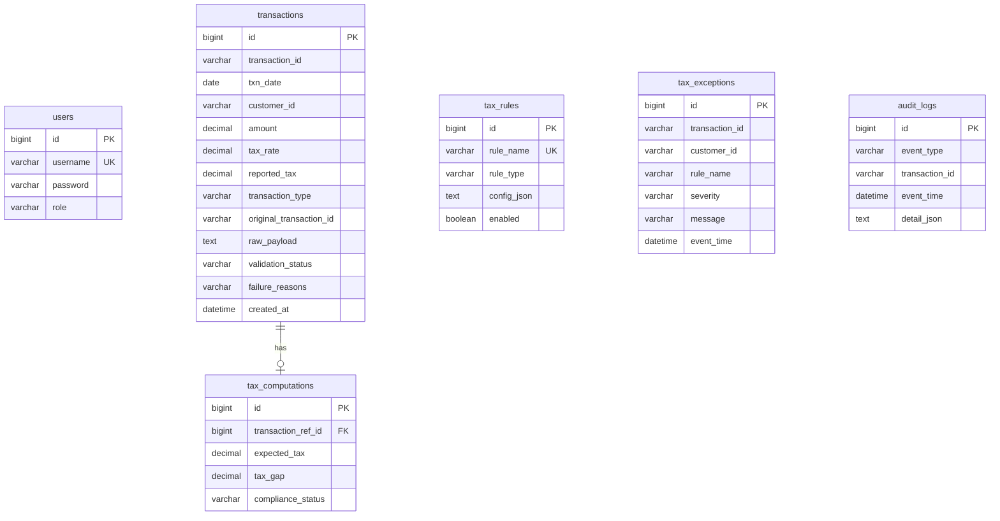

# Tax Gap Detection & Compliance Validation Service

Backend service for tax auditors. It accepts batches of financial transactions, validates them, computes the expected tax and the tax gap, runs configurable compliance rules from the database, records exceptions and an audit trail, and exposes summary reports.

Stack: Java 17, Spring Boot 3.2, Spring Security (HTTP Basic), Spring Data JPA / Hibernate, MySQL 8, Maven, JUnit 5 + Mockito, JaCoCo.

## Running the app

Prerequisites: JDK 17, Maven 3.9+, MySQL 8 (or Docker).

### Database setup

Option 1 - Docker:

```bash
docker compose up -d
```

Option 2 - local MySQL:

```sql
CREATE DATABASE taxgap;
```

The datasource settings live in `src/main/resources/application.properties` and can be overridden with environment variables: `DB_HOST`, `DB_PORT`, `DB_NAME`, `DB_USER`, `DB_PASSWORD` (defaults: localhost, 3306, taxgap, root, root).

Tables are created by Hibernate on startup (`ddl-auto=update`). On the first run a seeder inserts the users and the three default rules.

### Start

```bash
mvn spring-boot:run
```

The API is available at `http://localhost:8080`.

### Default users

| Username | Password    | Role    | Access                                  |
|----------|-------------|---------|-----------------------------------------|
| admin    | admin123    | ADMIN   | everything, including upload and rule toggle |
| auditor  | auditor123  | AUDITOR | read-only: exceptions, reports, rules, audit logs |

Passwords are stored as BCrypt hashes in the `users` table.

### Tests and coverage

```bash
mvn clean test
```

The JaCoCo report is generated at `target/site/jacoco/index.html`. The tests are plain unit tests (Mockito) and do not need a database.


## API

| Method | Path                              | Role           | Purpose |
|--------|-----------------------------------|----------------|---------|
| POST   | `/api/transactions/upload`        | ADMIN          | Upload a batch (JSON array) |
| GET    | `/api/exceptions`                 | ADMIN, AUDITOR | List exceptions; optional `customerId`, `severity`, `ruleName` |
| GET    | `/api/reports/customer-summary`   | ADMIN, AUDITOR | Per-customer tax summary |
| GET    | `/api/reports/exception-summary`  | ADMIN, AUDITOR | Exception totals and counts |
| GET    | `/api/rules`                      | ADMIN, AUDITOR | List rules |
| PUT    | `/api/rules/{id}/toggle`          | ADMIN          | Enable / disable a rule |
| GET    | `/api/audit-logs`                 | ADMIN, AUDITOR | Audit trail; optional `transactionId` |

### Sample calls

A ready-made batch is in `samples/transactions.json`.

```bash
# upload
curl -u admin:admin123 -X POST http://localhost:8080/api/transactions/upload \
  -H "Content-Type: application/json" \
  -d @samples/transactions.json

# all exceptions
curl -u auditor:auditor123 http://localhost:8080/api/exceptions

# filtered
curl -u auditor:auditor123 "http://localhost:8080/api/exceptions?customerId=C001&severity=HIGH"
curl -u auditor:auditor123 "http://localhost:8080/api/exceptions?ruleName=GST%20Slab%20Violation%20Rule"

# reports
curl -u auditor:auditor123 http://localhost:8080/api/reports/customer-summary
curl -u auditor:auditor123 http://localhost:8080/api/reports/exception-summary

# disable a rule (id 1)
curl -u admin:admin123 -X PUT http://localhost:8080/api/rules/1/toggle

# audit trail of one transaction
curl -u auditor:auditor123 "http://localhost:8080/api/audit-logs?transactionId=T1003"

# auditor is not allowed to upload -> 403
curl -u auditor:auditor123 -X POST http://localhost:8080/api/transactions/upload \
  -H "Content-Type: application/json" -d '[]'
```

### Sample upload payload

```json
[
  {
    "transactionId": "T1001",
    "date": "2026-10-01",
    "customerId": "C001",
    "amount": 1000.00,
    "taxRate": 0.18,
    "reportedTax": 180.00,
    "transactionType": "SALE"
  },
  {
    "transactionId": "T1004",
    "date": "2026-10-04",
    "customerId": "C001",
    "amount": 500.00,
    "taxRate": 0.18,
    "reportedTax": 90.00,
    "transactionType": "REFUND",
    "originalTransactionId": "T1001"
  }
]
```

### Sample upload response

```json
{
  "total": 2,
  "success": 2,
  "failure": 0,
  "results": [
    { "transactionId": "T1001", "validationStatus": "SUCCESS", "failureReasons": [], "complianceStatus": "COMPLIANT", "exceptionsRaised": 0 },
    { "transactionId": "T1004", "validationStatus": "SUCCESS", "failureReasons": [], "complianceStatus": "COMPLIANT", "exceptionsRaised": 0 }
  ]
}
```

## Database schema



`tax_exceptions` and `audit_logs` refer to a transaction by its business `transaction_id` rather than a foreign key, so failed or rejected records can still be traced. Indexes: `transactions(customer_id)`, `transactions(transaction_id)`, `tax_computations(compliance_status)`, `tax_exceptions(customer_id)`, `tax_exceptions(severity)`, `tax_exceptions(rule_name)`, `audit_logs(transaction_id)`, `audit_logs(event_type)`.

## Design

### Layers

```
controller  ->  service  ->  repository  ->  domain (JPA entities)
                   |
                   +-> rules (ComplianceRule implementations)
```

- **controller** - thin REST layer, no business logic.
- **service** - `TransactionService` orchestrates an upload; `TaxCalculationService`, `TransactionValidator`, `RuleEngineService`, `ExceptionService`, `AuditService`, `ReportService`, `RuleService` each own one concern.
- **rules** - one class per rule type behind the `ComplianceRule` interface.
- **repository** - Spring Data JPA interfaces; aggregate queries for reports are written in JPQL.
- **config** - security configuration, `UserDetailsService` backed by the `users` table, and the data seeder.

### Upload flow

For every record in the batch, `TransactionService`:

1. Validates the record. The raw payload is always stored. On any problem the record is saved with `FAILURE` and a list of reasons, an `INGESTION` audit entry is written, and processing moves on to the next record, so one bad record never fails the batch.
2. For a valid record, saves it as `SUCCESS` and writes an `INGESTION` audit entry.
3. Computes `expectedTax` and `taxGap`, stores a `tax_computations` row and writes a `TAX_COMPUTATION` audit entry. Anything other than `COMPLIANT` also creates an exception under the name `TAX_GAP_CHECK`.
4. Passes the transaction to the rule engine.

`date` and `transactionType` are received as strings in the request DTO and parsed manually. If they were typed as `LocalDate`/enum, Jackson would reject the whole request on the first bad value instead of letting that single record fail.

### Rule engine

Rules live in the `tax_rules` table: name, type, a JSON config column and an `enabled` flag. `RuleEngineService` loads only enabled rules for each transaction, looks up the `ComplianceRule` bean with the matching `type()`, and passes it the parsed JSON config. Each execution produces a `RULE_EXECUTION` audit entry (including rules that did not fire), and a violation becomes a row in `tax_exceptions`. Thresholds, slabs and severities are changed by editing the config in the database, and a rule is switched off through the toggle endpoint. Adding a new rule type means writing one new class that implements `ComplianceRule`.

Seeded rules:

| Rule | Type | Config |
|------|------|--------|
| High Value Transaction Rule | `HIGH_VALUE` | `{"threshold": 1000000, "severity": "HIGH"}` |
| Refund Validation Rule | `REFUND_VALIDATION` | `{"severity": "HIGH"}` |
| GST Slab Violation Rule | `GST_SLAB` | `{"slabs": [{"above": 50000, "minRate": 0.12}, {"above": 100000, "minRate": 0.18}], "severity": "MEDIUM"}` |

### Reports

Both reports are computed in SQL (`GROUP BY` with `SUM`/`COUNT`), not by loading rows into Java. The customer summary joins `tax_computations` with `transactions` and uses a conditional `SUM(CASE ...)` to count non-compliant transactions in the same pass. The exception summary uses two grouped count queries on indexed columns.

`complianceScore = 100 - (nonCompliantTransactions / totalTransactions * 100)`. Only transactions with status `NON_COMPLIANT` (reported tax missing) count as non-compliant, as defined in the requirement.

### Security

HTTP Basic, stateless, users and roles read from the `users` table with BCrypt hashes. Upload and rule toggling need `ADMIN`; everything else is open to `ADMIN` and `AUDITOR`.

## Assumptions

- `taxRate` is a fraction (`0.18` means 18%).
- `expectedTax` is rounded to 2 decimals (HALF_UP). All money values use `BigDecimal`.
- `reportedTax` is optional. When it is missing the status is `NON_COMPLIANT`, the missing value is treated as 0 for the gap, and it counts as 0 in report totals.
- A gap of exactly 1 or -1 is `COMPLIANT`.
- A repeated `transactionId` (one that already exists with `SUCCESS`) is rejected as a failure.
- **Refund rule:** the original sale is not part of the specified fields, so an optional `originalTransactionId` was added. If it is given, the refund must not exceed that sale, and the sale must exist and be of type `SALE`. If it is not given, the refund must not exceed the total of the customer's successful sales.
- **GST slab rule:** the slab with the highest `above` value that the amount exceeds decides the minimum rate.
- Tax gap exceptions use these severities: `UNDERPAID` = HIGH, `NON_COMPLIANT` = MEDIUM, `OVERPAID` = LOW.
- Numeric fields must be valid JSON numbers; a non-numeric value in those fields makes the request itself malformed (HTTP 400).
